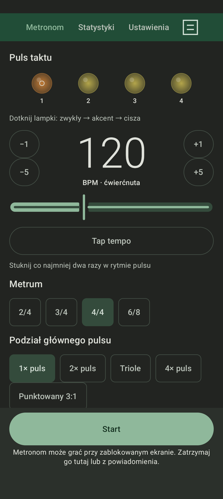
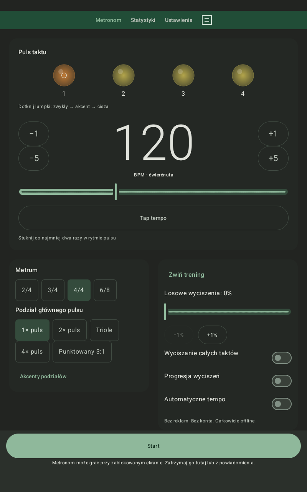

# OpenMetronome

Metronom na Androida dla muzyków, którzy chcą ćwiczyć nie tylko tempo,
ale też własne poczucie pulsu. Darmowy, otwartoźródłowy i całkowicie offline.
Bez reklam, subskrypcji, kont i Google Play Services.

## Pobierz i zacznij ćwiczyć

[Pobierz APK — 0.8.0-beta.1](https://github.com/Franek2009/OpenMetronome/releases/download/v0.8.0-beta.1/OpenMetronome-0.8.0-beta.1.apk)

[Opis wydania i sumy kontrolne](https://github.com/Franek2009/OpenMetronome/releases/tag/v0.8.0-beta.1)

Wersja **0.8.0-beta.1** jest wydaniem testowym, nie ukończoną wersją 1.0.
Wymagany Android **8.0 lub nowszy**. Telefon i tablet są obsługiwane w pionie
i poziomie.

1. Otwórz stronę wydań na urządzeniu i pobierz plik `.apk` z sekcji Assets.
2. Otwórz plik. Jeżeli Android poprosi, zezwól użytej przeglądarce lub menedżerowi
   plików na instalowanie aplikacji z tego źródła.
3. Zainstaluj aplikację, ustaw tempo i naciśnij **Start**.

Aktualizacje pobierasz z tej samej strony i instalujesz na istniejącą aplikację.
Nie trzeba jej odinstalowywać. Oficjalne wydania mają stały podpis cyfrowy.
**Wcześniejsze APK debug mają inny podpis:** jeśli aktualizacja jest odrzucana,
nie usuwaj aplikacji, jeśli zależy Ci na jej danych — [szczegóły](docs/RELEASING.md).

## Co potrafi?

- Tempo 20–300 BPM: przyciski, suwak, wpisywanie wartości i tap tempo.
- Metrum 2/4, 3/4, 4/4 i 6/8, akcenty oraz podziały rytmiczne.
- Trening pulsu: losowa cisza, całe ciche takty i stopniowo rosnąca trudność.
- Automatyczne zwiększanie i zmniejszanie tempa.
- Trzy brzmienia, regulacja głośności, wizualny puls i opcjonalne wibracje.
- Odtwarzanie w tle oraz zatrzymywanie z powiadomienia.
- Presety, lokalna historia ćwiczeń, statystyki i eksport do CSV.

W 6/8 BPM oznacza **ósemki — sześć głównych pulsów na takt**.
CSV to eksport historii, nie kopia zapasowa do przywracania danych.
[Więcej o ustawieniach i treningu](docs/USAGE.md).

## Jak wygląda?

| Telefon | Tablet |
| --- | --- |
|  |  |

Ciemny interfejs dopasowuje się do wielkości ekranu. Grafiki interfejsu są
własne; inspiracją układu były zrzuty Metronome Beats, nie kopiujemy ich do APK.

## Prywatność i status projektu

Ustawienia, presety i historia pozostają na urządzeniu. Nie ma analityki,
reklam ani komunikacji z naszym serwerem. Eksport uruchamiasz samodzielnie.
[Informacja o prywatności](PRIVACY.md).

Podstawowy dźwięk został sprawdzony przez użytkownika. Długie sesje i precyzja
rzeczywistego wyjścia audio nie mają jeszcze pełnego odbioru sprzętowego;
nie deklarujemy zakończenia stabilizacji. [Wyniki testów](docs/V0.8-VALIDATION.md).

Znalazłeś problem? [Zgłoś go na GitHubie](https://github.com/Franek2009/OpenMetronome/issues),
podając wersję aplikacji, model urządzenia, wersję Androida i kroki odtworzenia.
Nie przesyłaj kluczy podpisu ani prywatnych danych.

## Kod i współpraca

Projekt w Kotlinie i Jetpack Compose, na licencji [MIT](LICENSE).
Można budować z terminala na Linuxie, bez Android Studio.

- [Budowanie i testy](docs/BUILDING.md)
- [Architektura](docs/ARCHITECTURE.md) i [roadmapa](docs/ROADMAP.md)
- [Zmiany w wersjach](CHANGELOG.md) i [przygotowanie wydania](docs/RELEASING.md)

Pierwszym kanałem dystrybucji jest GitHub. Google Play i F-Droid nie są
jeszcze kanałami publikacji projektu.
