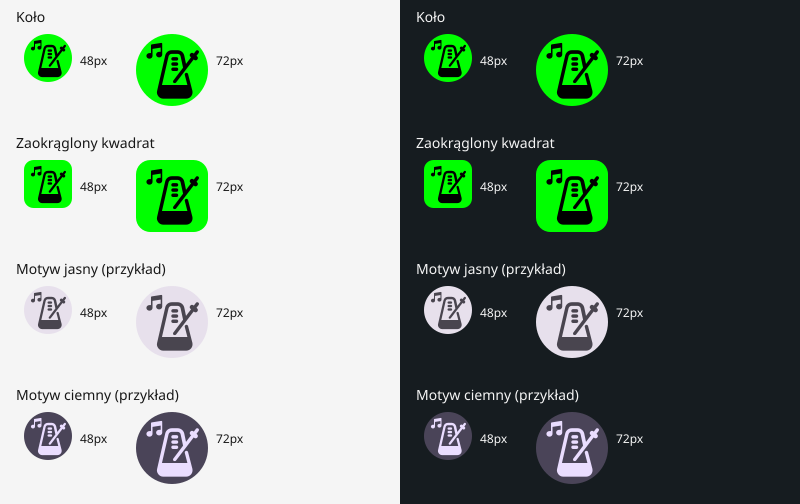

# Nowa ikona OpenMetronome — weryfikacja przed kolejnym RC

Stan: gałąź `feat/rc2-launcher-icon`, bez scalenia, tagu i nowego wydania.
Opublikowany v1.0.0-rc.1 pozostaje niezmieniony. Metadane wersji w Gradle nie
są podnoszone w tym PR; nowy kandydat wymaga osobnego zatwierdzenia.

## Podglądy do zatwierdzenia

Każdy wariant jest pokazany w rozmiarach 48 i 72 px na jasnym i ciemnym tle.
Motywy mają przykładowe palety; rzeczywiste kolory i maskę wybiera launcher.
Podgląd jest renderem geometrii wektorów, nie zrzutem fizycznego urządzenia.
Ocena wizualna użytkownika pozostaje otwarta.

## Zmiana i zachowane źródła

- `assets/Logo.svg` i PNG zachowane bajt w bajt, potwierdzone SHA-256.
  Zachowano także oba oryginalne SVG Repo. [Pochodzenie i licencje](../assets/SOURCES.md).
- Foreground: sześć dokładnych oryginalnych ścieżek, bez zielonych prostokątów,
  czarne wypełnienie i przezroczyste otwory. Zachowane proporcje oraz wzajemne
  położenie elementów, w tym dodatkowy element wahadła z projektu użytkownika.
- Jeden wspólny współczynnik skali/przesunięcie; najmniejszy okrąg obejmujący
  obrys, dopasowany do promienia 32,8 dp w warstwie 108 dp. Zapas 0,2 dp
  uwzględnia rasteryzację i próbkowanie krzywych. Nie upraszczano ścieżek.
- Background: nieprzezroczyste, jednolite `#00FF00`. Brak ciemnozielonych
  narożników i maski wypalonej w pierwszym planie.
- Osobny monochrome: identyczna geometria bez tła, do barwienia przez system.
- Adaptive XML w `mipmap-anydpi-v26`; na API 33+ wariant `v33` dodaje monochrome.
- Klasyczne PNG: mdpi 48, hdpi 72, xhdpi 96, xxhdpi 144, xxxhdpi 192 px.
  Przezroczyste narożniki, zielone zaokrąglone tło, bez ciemnej obwódki.
  Usunięto niekwalifikowany XML adaptive, aby nie zasłaniał fallbacków PNG.
- Manifest nadal wskazuje `@mipmap/ic_launcher`. Nie zmieniono nazwy aplikacji,
  `org.openmetronome`, konfiguracji klucza, minSdk 26 ani logiki aplikacji.
  Klasyczne zasoby nie oznaczają obniżenia wymaganego Androida poniżej 8.0.

Generator: `python3 scripts/generate-launcher-icons.py` (Python 3 i Inkscape).
Ponowne uruchomienie odtworzyło wszystkie zasoby i podgląd bit w bit.

## Zakres regresji

Nowy `LauncherIconTest` sprawdza rzeczywisty wybór zasobu przez PackageManager,
nieprzezroczyste jednolite zielone tło, dostępność monochrome na API 33+,
niezmienioną nazwę, przezroczystą sylwetkę i brak detali poza bezpiecznym
okręgiem. Porównanie masek dopuszcza 1/255 różnicy alfa przy antyaliasingu;
ścieżki wektorów mają dokładnie te same dane geometryczne. Nie uruchamia
Activity, odtwarzania, audio focus, wibracji ani operacji na danych aplikacji.

Testy kompilacji: JVM, Lint debug/release, assembleDebug,
assembleDebugAndroidTest i assembleRelease. Pełna cicha instrumentacja na
własnych emulatorach API 26/35 z allowAudio=false, allowHaptics=false.
Dodatkowo kontrola PNG, kwalifikatorów, manifestu i zasobów w unsigned APK.

| Weryfikacja końcowa | Wynik |
| --- | --- |
| JVM | 144 PASS, 0 FAIL/SKIPPED |
| Lint debug/release | PASS: po 0 błędów, 3 ostrzeżenia o nowszych narzędziach/bibliotekach |
| Debug, androidTest, unsigned release | PASS |
| Pełny cichy API 26 | 64 PASS, 6 AUDIO_SKIPPED, 0 OTHER_SKIPPED/FAIL; 142,302 s |
| Pełny cichy API 35 | 64 PASS, 6 AUDIO_SKIPPED, 0 OTHER_SKIPPED/FAIL; 166,491 s |
| Osobny test zasobów po korekcie tolerancji | po 2 PASS na API 26/35 |
| Oryginalne SVG/PNG i dokładne dane sześciu ścieżek | PASS: hashe bez zmian, pathData zgodne ze źródłem |
| Ponowne generowanie | PASS: wektory, XML, pięć PNG i podgląd bit w bit |
| Źródłowe i skompilowane klasyczne PNG | PASS: wszystkie pięć gęstości i rozmiarów |
| Zasoby w gotowym APK | PASS: tabela zasobów ma pięć density PNG i dwa adaptive; manifest wskazuje właściwe mipmap |
| Izolacja release | PASS: bez klasy testu ikony, debug probe, testowego providera i TestApplication |
| Lokalne odnośniki dokumentacji | PASS |

AAPT skraca nazwy plików w APK i optymalizuje kwalifikator v26 zgodnie
z minSdk 26. Kontrolę oparto na rzeczywistej tabeli zasobów, a nie nazwach
plików ze źródeł. Wybrany przez Androida wariant sprawdzono dodatkowo na
obu API. Podpisany APK nie był budowany: konfiguracja podpisu jest bez zmian,
a opublikowany RC.1 pozostaje dotychczasowym artefaktem.

Raporty lokalne: `.tooling/logo-audit/build-final.log`, `api26/`, `api35/`,
`apk/`, `generation.log` i `regeneration.log`. Pierwsze nieudane przebiegi
są zachowane osobno; tabela dotyczy końcowego kodu i testów.

## Przebiegi pośrednie i uwagi Lint

- Pierwszy start instrumentacji API 35 przerwała awaria systemu emulatora:
  DeadSystemException w system_server/SystemUI/Launcher. Raport niekompletny,
  bez zaliczenia; zachowano logi i powtórzono po restarcie systemu.
- Pierwsza wersja nowego testu porównywała alfa czarnej/białej warstwy dokładnie.
  Na obu API rasteryzacja różniła się o 1/255 na wygładzonej krawędzi. Zmieniono
  tolerancję testu na 1/255; geometrii i proporcji logo nie zmieniano.
- `app/lint.xml` wyłącza tylko dwa zgłoszenia dotyczące konkretnych ścieżek:
  ObsoleteSdkInt dla v26 (celowo zachowany fallback legacy) i
  MonochromeLauncherIcon dla bazowego XML v26 (wariant v33 dostarcza maskę,
  co sprawdza test na API 35). Nie wyłączono tych reguł globalnie.

Lokalne logi: `.tooling/logo-audit/`. Nie używano fizycznych telefonów,
nie kasowano danych i nie uruchamiano dźwięku/wibracji. Odbiór M6 i stabilne
1.0 nie są deklarowane jako ukończone przez zmianę ikony.
